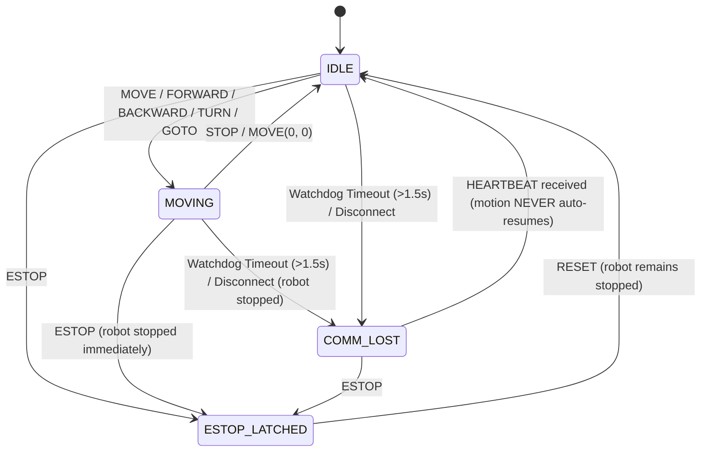

# AISR Milestone 2: Commands and Safety Architecture

This document describes the command protocol, state machine, heartbeat watchdog, emergency-stop subsystem, and client/server teleoperation architecture implemented in Milestone 2 of the AISR robot teleoperation project.

---

## 1. System Architecture

The robot teleoperation system is structured into layered, decoupled components:

```
+-------------------------------------------------------------+
|                     TCP Client (Operator)                  |
|  - Interactive CLI ("AISR> ") in main thread               |
|  - Background thread: Heartbeat sender (every 0.5s)         |
|  - Background thread: Async response reader                |
+------------------------------+------------------------------+
                               |
                   TCP / JSON-over-Newline
                               |
+------------------------------v------------------------------+
|                     TCP Server (Robot Host)                 |
|  - MessageBuffer framing for stream reassembly              |
|  - Socket timeout (0.5s) decouples recv from watchdog       |
+------------------------------+------------------------------+
                               |
+------------------------------v------------------------------+
|                     SafetyController                        |
|  - State machine: IDLE, MOVING, COMM_LOST, ESTOP_LATCHED   |
|  - Independent watchdog thread (checks every 0.25s)         |
|  - Velocity, range, NaN/Inf and type validation             |
|  - Thread-safe command dispatching                          |
+------------------------------+------------------------------+
                               |
+------------------------------v------------------------------+
|               RobotInterface Backend Layer                   |
|  - Abstract hardware abstraction layer                      |
|  - MockRobot: in-memory command logging & test double       |
|  - CoppeliaSimRobot: ZeroMQ Remote API Pioneer P3-DX        |
|  - Selection via create_robot_backend(mock | coppeliasim)   |
+-------------------------------------------------------------+
```

---

## 2. Operational State Machine

The robot operates under four mutually exclusive states defined in `src.safety.RobotState`:

| State | Description | Motion Allowed? |
| :--- | :--- | :--- |
| **`IDLE`** | Robot is stationary and ready to accept movement commands. | Yes |
| **`MOVING`** | Robot is actively executing a velocity or target coordinate command. | Yes |
| **`COMM_LOST`** | Heartbeat expired (>1.5s) or client disconnected. Robot is stopped. | No (Awaiting heartbeat) |
| **`ESTOP_LATCHED`** | Emergency stop was triggered. Robot is stopped and latched. | No (Requires RESET) |

### State Transitions



### Safety Invariants

1. **E-Stop Priority:** `ESTOP_LATCHED` overrides all states. Communication loss or watchdog timeouts never clear an active emergency stop latch.
2. **No Auto-Resumption:** Recovery from `COMM_LOST` via `HEARTBEAT` transitions the state strictly to `IDLE`. The robot never resumes previous motion automatically.
3. **Reset Safety:** Clearing `ESTOP_LATCHED` via `RESET` transitions strictly to `IDLE` with all motor velocities set to 0. A distinct, fresh movement command is mandatory to initiate motion again.
4. **Movement Rejection in COMM_LOST:** While in `COMM_LOST`, all motion commands are rejected with `"status": "rejected"`. Communication must be acknowledged via heartbeat first.

---

## 3. Heartbeat Watchdog Subsystem

- **Client Transmission:** The client transmits a `{"type": "HEARTBEAT"}` message every **0.5 seconds** via a background daemon thread (`_heartbeat_loop`).
- **Server Verification:** The server watchdog runs in a dedicated thread (`_watchdog_loop`) checking elapsed time since the last heartbeat every **0.25 seconds**.
- **Timeout Threshold:** If no heartbeat is received within **1.5 seconds** (`SafetyConfig.heartbeat_timeout = 1.5`):
  1. The robot backend `stop()` method is immediately invoked to cut motor power.
  2. The state transitions to `COMM_LOST` (unless already `ESTOP_LATCHED`).
- **Independence from Socket I/O:** The server socket uses a short timeout (`SOCKET_TIMEOUT = 0.5s`), preventing `recv()` from blocking the event loop or watchdog thread.

---

## 4. Emergency Stop & Reset Subsystem

- **`ESTOP` Command:**
  - Can be dispatched at any time, from any state.
  - Instantly invokes `robot.stop()`.
  - Sets state to `ESTOP_LATCHED`.
  - Returns `{"type": "ESTOP_ACK", "state": "ESTOP_LATCHED", "status": "ok", "message": "..."}`.
  - Repeated `ESTOP` calls are idempotent and safe.
- **Motion Rejection:**
  - While latched, all movement commands (`MOVE`, `FORWARD`, `BACKWARD`, `TURN_LEFT`, `TURN_RIGHT`, `GOTO`) are immediately rejected with `{"type": "ERROR", "status": "rejected", "message": "Emergency stop is active. Send RESET first."}`.
  - Non-motion inspection commands like `STATUS` and `PING` remain functional.
- **`RESET` Command:**
  - Only valid when currently in `ESTOP_LATCHED`; otherwise rejected with `"status": "error"`.
  - Re-asserts `robot.stop()` to guarantee 0 velocity.
  - Transitions state to `IDLE`.
  - Requires subsequent explicit motion commands from the operator.

---

## 5. Command Reference Table

All messages are UTF-8 newline-delimited JSON objects (`\n`).

| Command | Arguments | Example Payload | Example Response |
| :--- | :--- | :--- | :--- |
| **`HEARTBEAT`** | None | `{"type": "HEARTBEAT"}` | `{"type": "HEARTBEAT_ACK", "state": "IDLE", "status": "ok"}` |
| **`FORWARD`** | `speed` (opt, float > 0), `duration` (opt, float > 0) | `{"type": "FORWARD", "speed": 1.0, "duration": 2.0}` | `{"type": "FORWARD_ACK", "state": "MOVING", "status": "ok", "speed": 1.0, "duration": 2.0}` |
| **`BACKWARD`** | `speed` (opt, float > 0), `duration` (opt, float > 0) | `{"type": "BACKWARD", "speed": 0.5, "duration": 1.5}` | `{"type": "BACKWARD_ACK", "state": "MOVING", "status": "ok", "speed": 0.5, "duration": 1.5}` |
| **`TURN_LEFT`** | `speed` (opt, float > 0), `duration` (opt, float > 0) | `{"type": "TURN_LEFT", "speed": 30.0, "duration": 1.0}` | `{"type": "TURN_LEFT_ACK", "state": "MOVING", "status": "ok", "speed": 30.0, "duration": 1.0}` |
| **`TURN_RIGHT`** | `speed` (opt, float > 0), `duration` (opt, float > 0) | `{"type": "TURN_RIGHT", "speed": 45.0, "duration": 2.0}` | `{"type": "TURN_RIGHT_ACK", "state": "MOVING", "status": "ok", "speed": 45.0, "duration": 2.0}` |
| **`MOVE`** | `linear` (float), `angular` (float) | `{"type": "MOVE", "linear": 1.2, "angular": -30.0}` | `{"type": "MOVE_ACK", "state": "MOVING", "status": "ok", "linear": 1.2, "angular": -30.0}` |
| **`GOTO`** | `x` (float), `y` (float) | `{"type": "GOTO", "x": 5.0, "y": 10.0}` | `{"type": "GOTO_ACK", "state": "MOVING", "status": "ok", "target_x": 5.0, "target_y": 10.0}` |
| **`STOP`** | None | `{"type": "STOP"}` | `{"type": "STOP_ACK", "state": "IDLE", "status": "ok"}` |
| **`STATUS`** | None | `{"type": "STATUS"}` | `{"type": "STATUS_RESPONSE", "state": "IDLE", "status": "ok", "x": 0.0, "y": 0.0, "heading_deg": 0.0, "linear_velocity": 0.0, "angular_velocity": 0.0, "is_moving": false}` |
| **`ESTOP`** | None | `{"type": "ESTOP"}` | `{"type": "ESTOP_ACK", "state": "ESTOP_LATCHED", "status": "ok", ...}` |
| **`RESET`** | None | `{"type": "RESET"}` | `{"type": "RESET_ACK", "state": "IDLE", "status": "ok", ...}` |
| **`PING`** | None | `{"type": "PING"}` | `{"type": "ACK", "received_type": "PING", "status": "ok", "state": "IDLE"}` |

### Continuous vs. Timed Movement

The teleoperation protocol supports two distinct movement modes:

1. **Continuous Motion (Default):**
   - Triggered when `duration` is omitted (e.g. `FORWARD 0.5` or `FORWARD`).
   - The robot commands the velocity and transitions to `MOVING`.
   - Motion continues indefinitely until explicitly stopped by `STOP`, `ESTOP`, `RESET`, client disconnect, or heartbeat watchdog timeout.
2. **Timed Motion:**
   - Triggered when optional positive duration (in seconds) is provided (e.g. `FORWARD 0.1 1.0` or `BACKWARD 0.2 2.5`).
   - The robot starts moving and schedules a high-precision concurrency-safe timer.
   - When the duration expires, the robot automatically halts (`stop()`) and transitions back to `IDLE`.
   - An ACK containing `"duration": <seconds>` confirms timed execution.

### Safe Timed Motion & Concurrency Guarantees

To ensure rock-solid safety in multi-threaded network environments:
- **Generation Counter:** Every motion timer is stamped with a monotonic generation ID (`_motion_generation`). When any new motion command is received, the previous timer is cancelled and the generation increments.
- **Stale Timer Immunity:** If a timer fires late after being superseded by another movement, it detects a generation mismatch and exits immediately without altering robot state or stopping the new motion.
- **Safety Overrides:** `STOP`, `ESTOP`, `RESET`, client disconnect (`on_client_disconnect`), heartbeat watchdog timeout (`COMM_LOST`), and server shutdown all cancel any active timers and ensure the robot is stopped immediately.

---

## 6. Input Validation & Numeric Safety Limits

The safety controller rigorously validates all command parameters before dispatch:

- **Type Checking:** Rejects non-numeric types and booleans (`True`/`False` are not valid velocities or durations).
- **Non-Finite Number Rejection:** Rejects `NaN`, `+Infinity`, and `-Infinity`.
- **Sign & Duration Validation:**
  - Directional commands enforce non-negative speeds (`speed >= 0`).
  - Duration, when provided, must be strictly positive (`duration > 0`), finite, and non-boolean.
  - Excessive durations exceeding `max_duration = 300.0`s are rejected.
- **Configurable Thresholds (`SafetyConfig`):**
  - Linear velocity limit: `max_linear_speed = 2.0` m/s (`|v| ≤ 2.0`).
  - Angular velocity limit: `max_angular_speed = 90.0` deg/s (`|ω| ≤ 90.0`).
  - Coordinate range limit: `max_goto_range = 1000.0` m (`|x|, |y| ≤ 1000.0`).
  - Maximum motion duration: `max_duration = 300.0` s.
  - Default linear speed: `default_speed = 0.5` m/s.
  - Default angular speed: `default_turn_speed = 45.0` deg/s.

---

## 7. Client Interactive Shell

The client interface (`src.tcp_client`) provides an operator REPL:

```
AISR> FORWARD 1.0
  → Sent: {"type": "FORWARD", "speed": 1.0}
  ← Server: {"type": "FORWARD_ACK", "state": "MOVING", "status": "ok", "speed": 1.0}

AISR> STATUS
  → Sent: {"type": "STATUS"}
  ← Server: {"type": "STATUS_RESPONSE", "state": "MOVING", "status": "ok", "x": 0.0, "y": 0.0, "heading_deg": 0.0, "linear_velocity": 1.0, "angular_velocity": 0.0, "is_moving": true}

AISR> ESTOP
  → Sent: {"type": "ESTOP"}
  ← Server: {"type": "ESTOP_ACK", "state": "ESTOP_LATCHED", "status": "ok", "message": "Emergency stop activated. Use RESET to clear."}

AISR> FORWARD 0.5
  → Sent: {"type": "FORWARD", "speed": 0.5}
  ← Server: {"type": "ERROR", "status": "rejected", "state": "ESTOP_LATCHED", "message": "Emergency stop is active. Send RESET first."}

AISR> RESET
  → Sent: {"type": "RESET"}
  ← Server: {"type": "RESET_ACK", "state": "IDLE", "status": "ok", "message": "Emergency stop cleared. Robot is IDLE."}
```

Heartbeat ACKs (`HEARTBEAT_ACK`) are received and processed silently in the background to keep the operator terminal clean and focused.

---

## 8. Verification & Test Suite

The test suite consists of **171 automated tests** across three test modules:

1. **`tests/test_protocol.py` (32 tests):**
   - JSON newline framing and encoding/decoding.
   - Message validation and error handling.
   - `MessageBuffer` fragmented streaming, partial messages, and multiple frames per packet.
   - End-to-end TCP loopback socket integration.

2. **`tests/test_safety.py` (98 tests):**
   - Initial state and stationary verification.
   - Movement commands (`FORWARD`, `BACKWARD`, `TURN_LEFT`, `TURN_RIGHT`, `MOVE`, `GOTO`, `STOP`).
   - Timed movement execution, duration expiry, and transition to `IDLE`.
   - Concurrency safety: newer movement superseding and cancelling older timers.
   - Stale timer immunity preventing late callbacks from stopping new motion.
   - Timer cancellation on `STOP`, `ESTOP`, `RESET`, client disconnect, watchdog timeout, and server shutdown.
   - Command validation: negative speeds, duration validation, bounds checking, boolean and NaN/Inf rejection.
   - Deterministic watchdog expiry and refresh via injectable `FakeClock`.
   - Recovery without automatic resumption of motion.
   - Emergency-stop latching, motion blockage, and idempotent calls.
   - Reset safety and motion resumption only via fresh commands.
   - Client disconnect stopping robot and retaining E-stop priority.
   - Independent background watchdog thread execution with short timeout.
   - Real TCP integration with `SafetyController`.

3. **`tests/test_coppeliasim.py` (41 tests):**
   - Scene object resolution (`PioneerP3DX`, `leftMotor`, `rightMotor`) via exact paths, relative proxies, and aliases.
   - Differential drive wheel speed calculation ($R=0.0975\text{ m}, L=0.331\text{ m}$) across forward, backward, left, right, and dual velocities.
   - Wheel velocity limits clamping with curvature preservation.
   - Zero-velocity stop operation leaving simulator clock unchanged.
   - Simulation state handling (stopped, paused, running, auto-start).
   - Backend factory selection (`mock` vs `coppeliasim`) without silent fallback.
   - Status reporting accuracy: zero physical velocity and stationary flag when simulation is stopped or paused.
   - Normalization of IEEE `-0.0` floating point artifacts and sensor deadband jitter filtering.
   - Live status reporting translation to `RobotStatus`.
   - Safety controller integration with simulated Pioneer joints.

For complete CoppeliaSim integration details, setup steps, and running instructions, see [CoppeliaSim Pioneer P3-DX Integration Guide](file:///d:/AISR-Project/docs/coppeliasim_integration.md).

Run the full suite using:
```bash
python -m unittest discover -s tests -v
```
